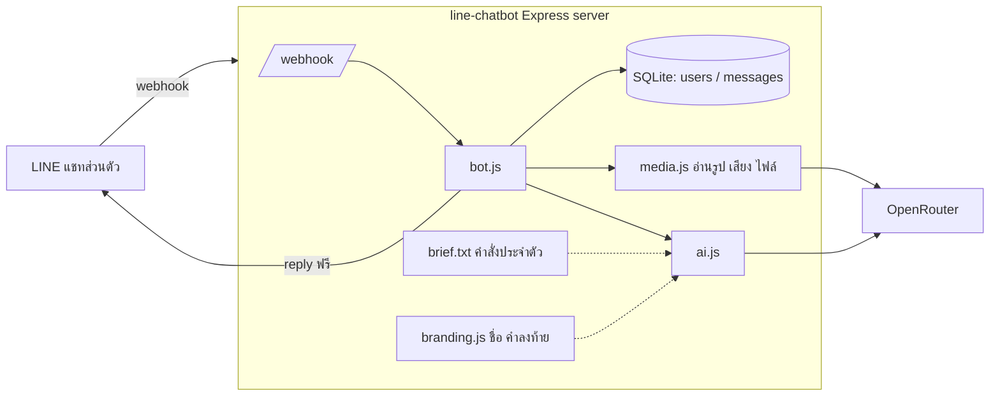
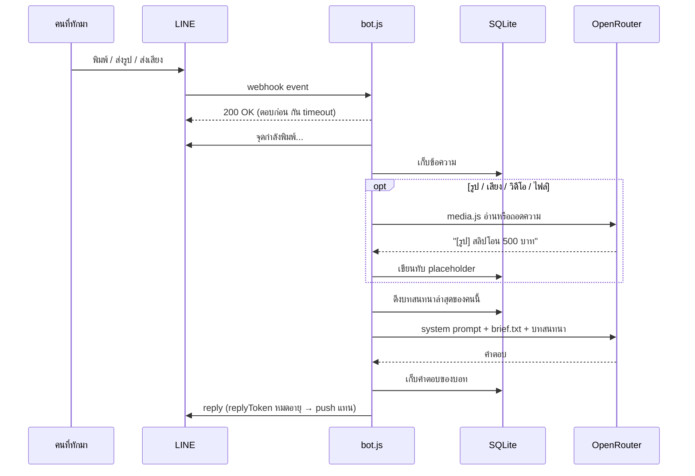

# การทำงานของระบบ

เอกสารนี้อธิบายว่าข้อความไหลยังไง ตั้งแต่มีคนทักบอทในแชทส่วนตัว จนบอทตอบกลับ

## ภาพรวม

## ข้อความหนึ่งข้อความ

## event ที่บอทรับ

| event | บอททำอะไร |
|---|---|
| แอดเพื่อน (`follow`) | จำชื่อจากโปรไฟล์ แล้วทักทาย (`BOT_GREETING`) |
| ข้อความ / สื่อ | เก็บ → อ่านสื่อ → ให้ AI ตอบจากบทสนทนา |
| ยกเลิกข้อความ (`unsend`) | ลบข้อความนั้นออกจากความจำ |
| ถูกเชิญเข้ากลุ่ม (`join`) / มีข้อความในกลุ่ม | บอกสั้นๆ ว่าคุยได้เฉพาะแชทส่วนตัว แล้วออก |
| ครบ `DAILY_LIMIT` ของวันนั้น | ตอบสั้นๆ ว่าครบแล้ว ไม่เรียก AI |

## ความจำ

- แต่ละคนมีบทสนทนาของตัวเองในตาราง `messages` (แยกด้วย LINE userId)
- ทุกครั้งที่ตอบ บอทส่งบทสนทนาล่าสุดราว 6,000 ตัวอักษรให้ AI — เกินกว่านั้นตัดของเก่าสุดทิ้ง
- ข้อความของคนมีเวลาไทยกำกับ AI จึงรู้ว่า "วันนี้" คุยอะไรกันบ้าง และสรุปให้ได้เมื่อถูกขอ

## คำสั่งประจำตัว

`brief.js` อ่าน `BOT_BRIEF` จาก `.env` (ไม่ตั้ง → อ่านไฟล์ `brief.txt`) ครั้งเดียวตอนบูต แล้ว `ai.js` ต่อท้าย system prompt ทุกข้อความ

- บรรทัดขึ้นต้น `#` = หมายเหตุ ไม่ส่งให้ AI
- ยาวเกิน 8,000 ตัวอักษรถูกตัดท้าย (เตือนใน log ตอนบูต)
- กติกาพื้นฐานที่ล็อกไว้ใน prompt: ห้ามเดาข้อมูลเฉพาะ · ห้ามใช้ markdown · ห้ามรับปากงานนอกแชท · ห้ามทวนรหัสผ่าน/OTP
